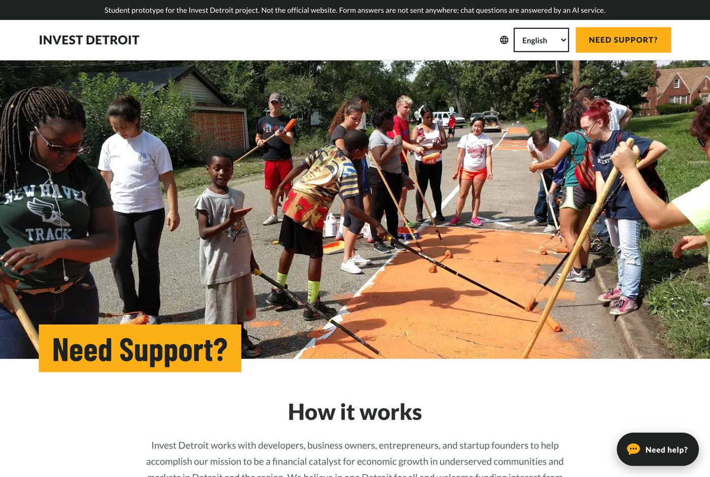
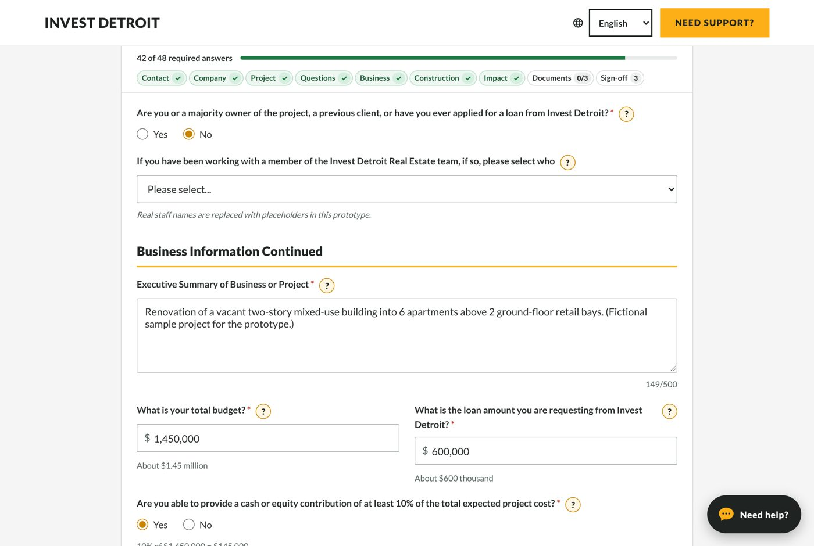
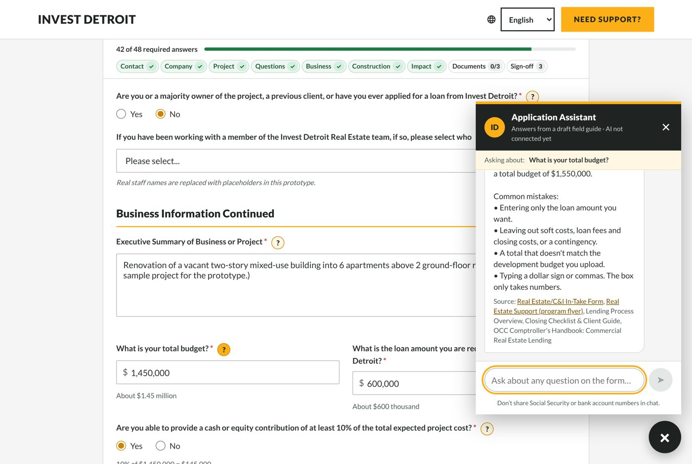
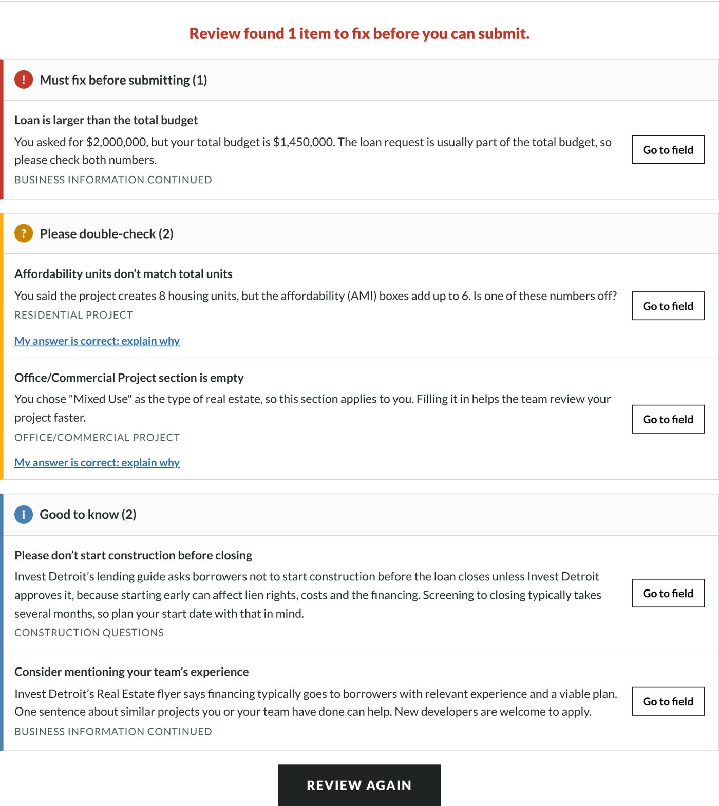
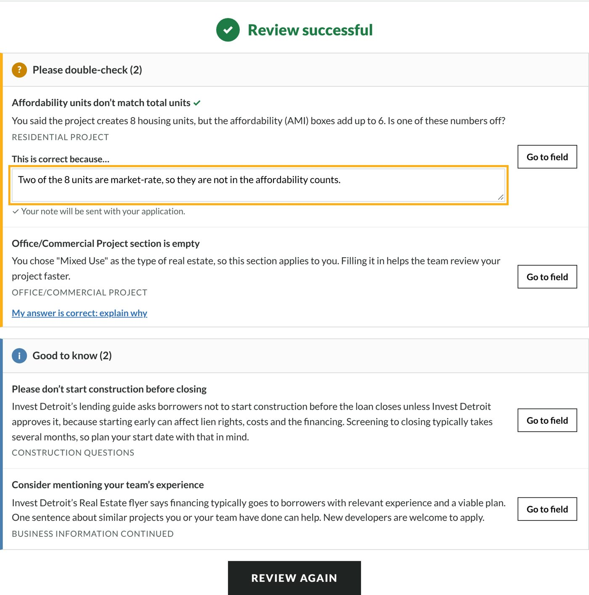
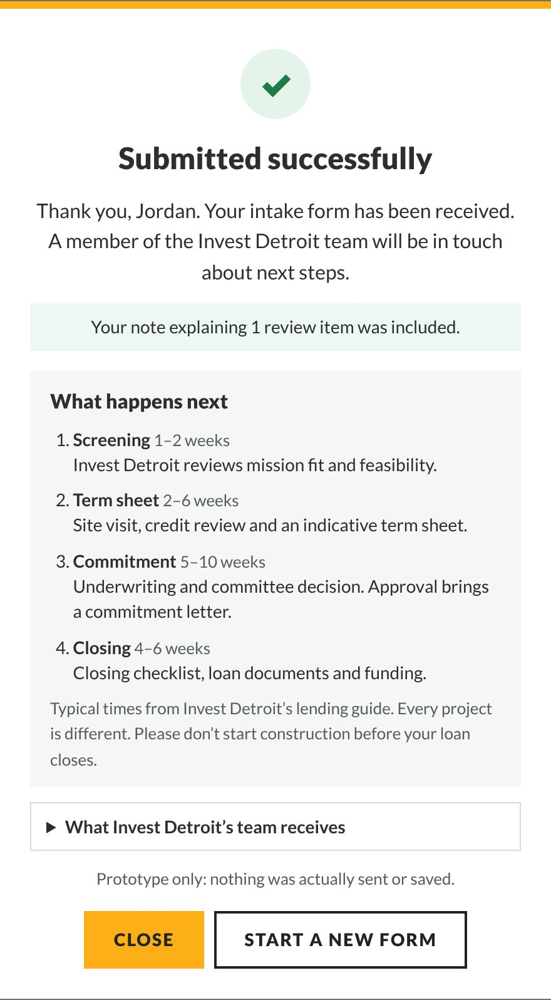
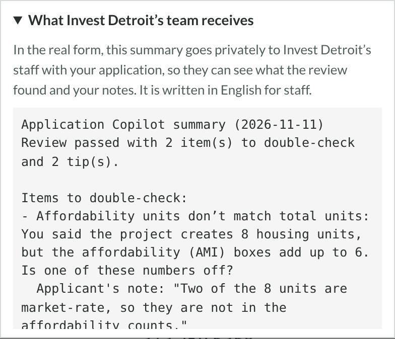

# Quick start

**Link:** https://invest-detroit-project-1.onrender.com  ·  **Videos:** [ADD APPLICANT VIDEO LINK] · [ADD STAFF VIDEO LINK] · [ADD 60-SECOND OVERVIEW LINK]

**Applicants:**

1. Open the link and fill in the form. The bar at the top shows what is left.
2. Stuck on a question? Press the yellow **?** next to it, or open **Need help?** at the bottom right.
3. Press **Review My Application** and fix anything under **Must fix**.
4. For each **Please double-check** item, fix the answer or press **My answer is correct: explain why**.
5. Press **Submit**.

**Screening staff:** read the **Application Copilot summary** that comes with each application before you start screening.

**Who to contact:**

- Questions about an application: the Invest Detroit team, info@investdetroit.com or 313.259.6368.
- Problems with the tool itself: [NAMED OWNER AT INVEST DETROIT].

# What it's for

The copilot sits on top of Invest Detroit's Real Estate/C&I In-Take Form. It helps **applicants** (developers and business owners) send a complete, correct application the first time. It gives **screening staff** a short list of what to double-check, so fewer applications need follow-up emails.

It explains, checks and points to sources. It never decides anything: approval, eligibility, rates and terms stay with Invest Detroit staff.

# Step by step: applicants

## 1. Open the page

The page looks like Invest Detroit's **Need Support?** page. **How it works** and **Before you start** sum up what you'll need: the 3 required documents (project plan, development budget, team list) and your key numbers. Choose your language at the top: English, Español, العربية, বাংলা or 中文.

## 2. Fill in the form

The bar at the top counts the required answers and shows each section. A green tick means that section is done; tap a section to jump to it. Dollar boxes add the commas for you and show the amount in words ("About $1.45 million"). Your answers are saved **on this device only** for 7 days, so you can come back later. The SSN box is never saved.

## 3. Get help on a question

Press the yellow **?** next to any question. The assistant explains the question, gives an example and lists common mistakes. **Source** shows which Invest Detroit document the answer comes from. You can also type your own question.

## 4. Review My Application

When you're done, press **Review My Application**. It takes a few seconds and shows three groups:

- **Must fix (red):** Submit stays locked until these are fixed. Example: a required question is blank, or the email has no ".com".
- **Please double-check (orange):** these numbers look unusual but may be right. Fix the answer, or explain it.
- **Good to know (blue):** tips that never block anything.

**Go to field** takes you straight to the question.

## 5. Explain an answer that is correct

If a double-check item is actually right, press **My answer is correct: explain why** and write one sentence. The note goes with your application, so staff don't have to email you to ask.

## 6. Submit

Press **Submit**. You'll see **What happens next**: screening (1–2 weeks), term sheet, commitment and closing, with typical times from Invest Detroit's lending guide.

# Step by step: screening staff

## 1. Read the copilot summary

Every application comes with a short **Application Copilot summary**. It is always in English, whatever language the applicant used, and it never contains an SSN. It lists:

- whether the review passed;
- each **item to double-check**, with the applicant's own note if they wrote one;
- the tips the applicant saw;
- the language they used, if it wasn't English.

**What to do:** check each double-check item against the uploaded documents first. If there's a note, judge whether it explains the item. If there's no note, that's your first follow-up question.

## 2. Usage reports

The copilot also counts, anonymously, where applicants stop, which questions they need help with and how they rate the chat. These counts go into Invest Detroit's own reporting system; ask your data team for the report. A question that gets many **?** presses, or a common review finding, usually means the form's wording could be clearer.

# Understanding the results: one example

**Input:** the sample applicant (a 6-apartment mixed-use rehab with a $1,450,000 budget), with two mistakes added: housing units changed to **8**, and the loan request typed as **$2,000,000**.

**Result:**

| What the review said | What it means | What to do |
|---|---|---|
| **Must fix:** Loan is larger than the total budget | $2,000,000 is more than the $1,450,000 project. Usually a typo. | Correct the loan to $600,000. Submit unlocks. |
| **Double-check:** Affordability units don't match total units | 8 units, but the AMI boxes add up to 6. | Either fix the count, or explain: "Two units are market-rate." |
| **Double-check:** Office/Commercial section is empty | A mixed-use project usually has office or retail space. | Fill it in, or explain why it doesn't apply. |
| **Good to know:** Don't start construction before closing | Invest Detroit's lending guide asks borrowers to wait. | Nothing to fix. |

The staff summary for this application then lists the two double-check items, with the applicant's note under the first.

# What to check before acting on a result

- **Review results are reminders, not decisions.** A passed review doesn't mean the application is complete or eligible. Staff still read the documents.
- **Chat answers about Invest Detroit** (rates, fees, steps) come from Invest Detroit documents and show their source. Published ranges are "subject to change"; confirm current terms before quoting them to a borrower.
- **Uploaded files** are checked only for type, size and empty files. The copilot does not read what's inside them.
- **Applicant notes** are the applicant's own words. Verify them against the documents.

# Never trust it to

- decide or predict approval, eligibility, or a borrower's rate, fees or terms;
- judge creditworthiness, legal questions or tax questions;
- confirm that a property is inside Detroit city limits (use the City's Parcel Viewer);
- verify what's inside uploaded documents;
- replace a conversation with the applicant about anything unusual.

# When something goes wrong

| What you see | What it means | What to do |
|---|---|---|
| "I don't have an approved answer for that question" | The question isn't covered by the knowledge base. | Contact the Invest Detroit team (email and phone are in the message). Staff: tell the owner, so it can be added. |
| "I want to make sure I help with the right thing…" | The question was unclear. A known example: "My ZIP is 48212, am I in Detroit?" | Ask in other words, or press **?** on the question itself. |
| "I'm here to help you with your Invest Detroit loan application…" | The question was off-topic, or tried to change the assistant's rules. | Ask about the application. |
| "Applications need to be accurate and truthful…" | The question sounded like leaving out or changing information. | Ask how to report the figure correctly. |
| "That looks like a Social Security Number…" | Sensitive numbers are hidden and never sent. | Put sensitive details only in the secure form fields. |
| Answers are only in English | The AI isn't connected; the built-in guide is English. | The owner adds the OpenAI key (README). |
| Page takes about 30 seconds to open | The free hosting plan sleeps when unused. | Wait, or move to Render's paid plan (about $7 a month). |
| Review flags something that is right | Rules can't know every situation. | Press **My answer is correct: explain why**. |

*Screenshots use the fictional sample applicant "Jordan Ellis". No real people or data appear in this guide.*
